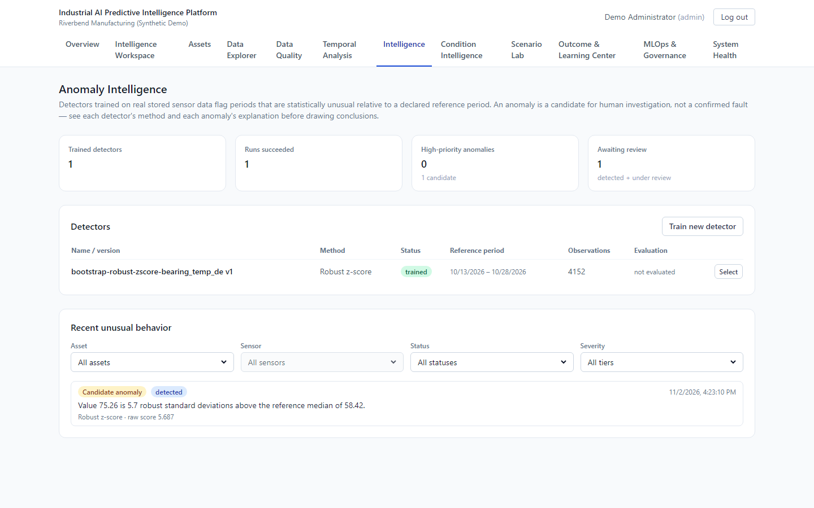
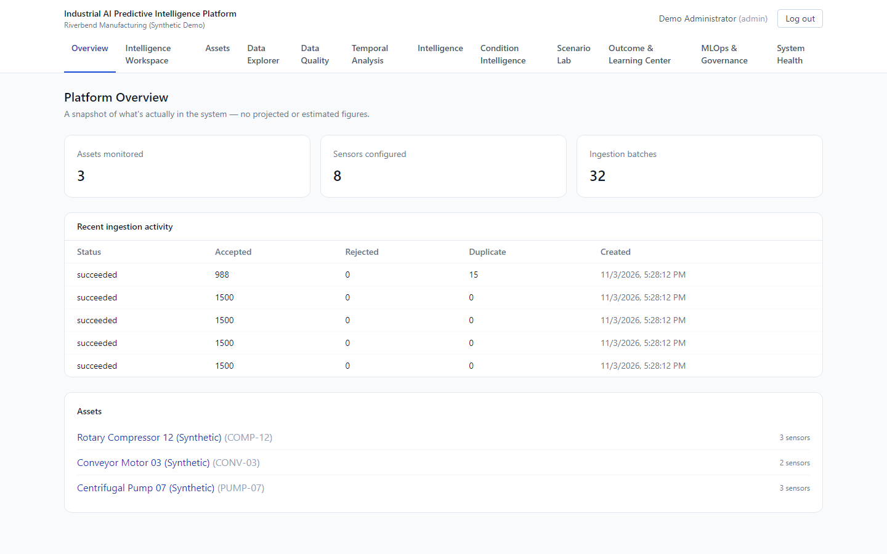
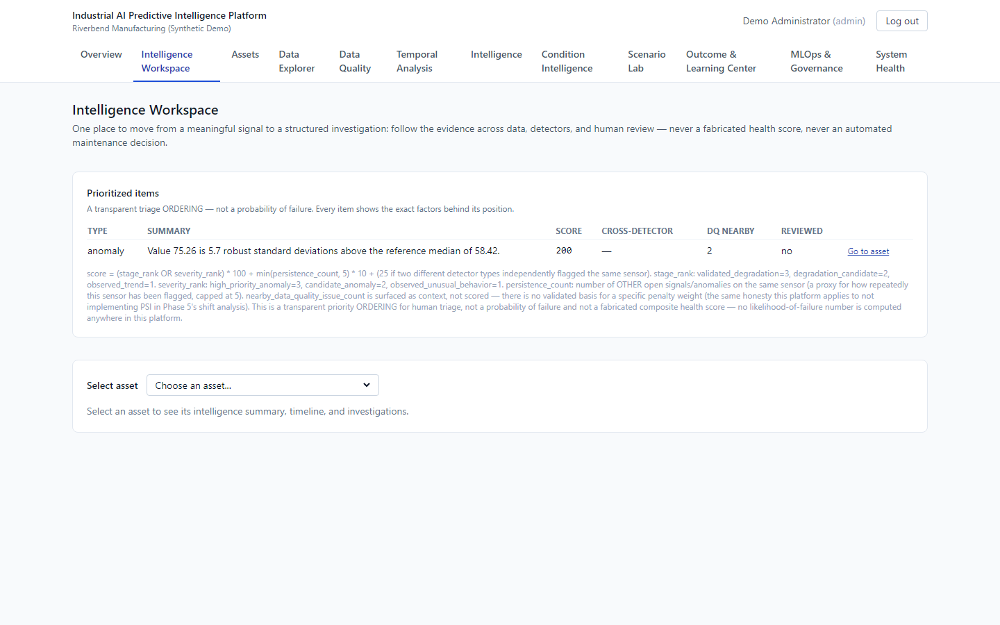
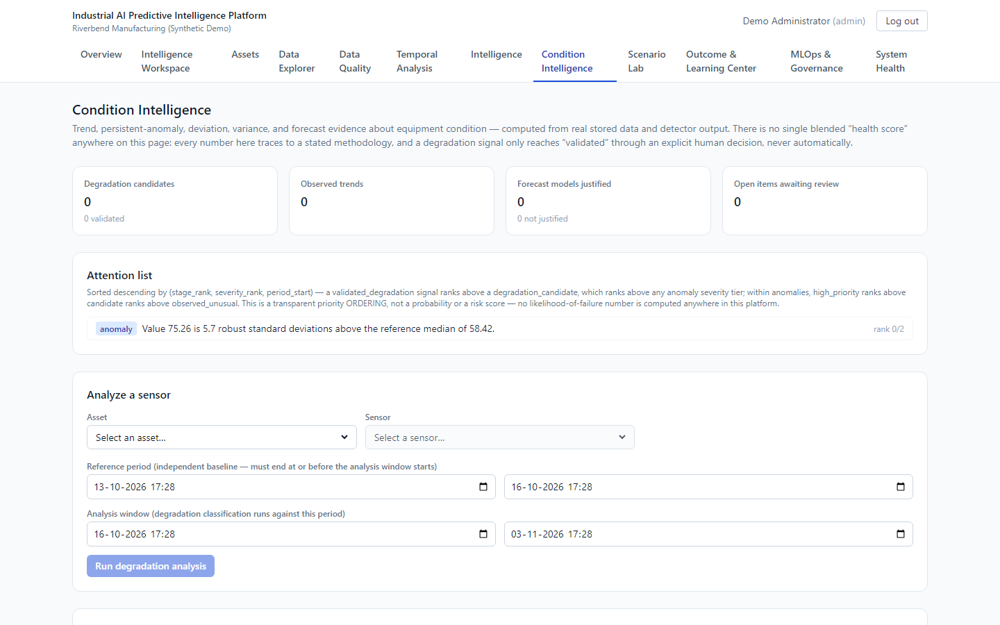
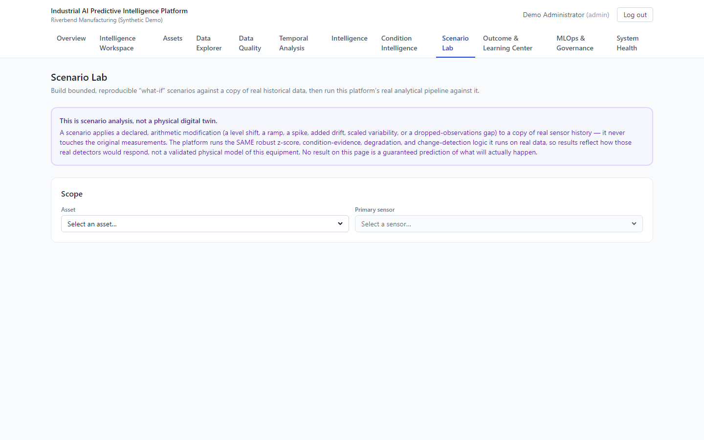
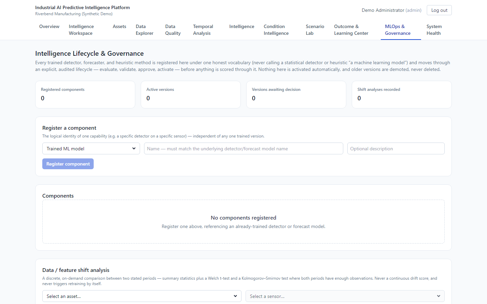
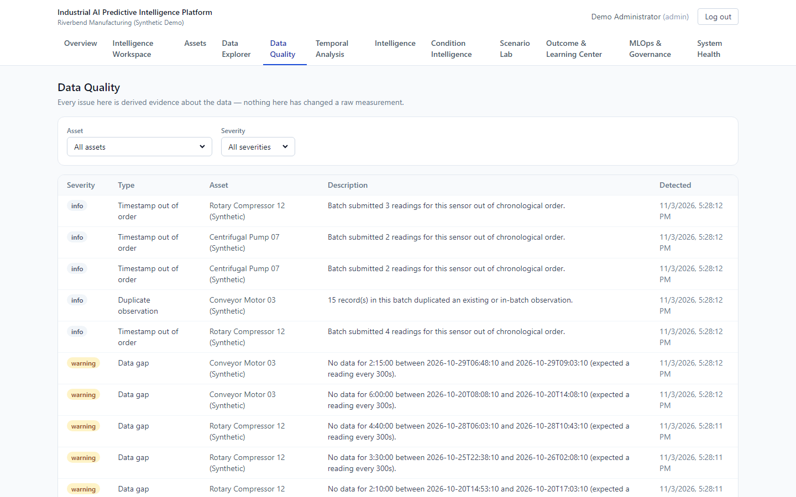
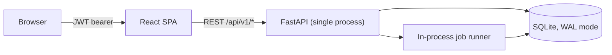

# Industrial AI Predictive Intelligence Platform

A decision-support platform for industrial equipment monitoring: it
ingests sensor time-series data, validates and stores it immutably,
detects statistically unusual behavior with three complementary methods
(including a multivariate robust-covariance detector that catches
relationship breakdowns a single-sensor or feature-ensemble method
cannot), tracks long-term condition evidence with a backtest-gated
forecaster,
governs every one of those intelligence outputs through a real MLOps
lifecycle, and connects it all into one evidence-based investigation
workspace — hardened for real operation with explicit deployment
architecture, honest health/readiness checks, and a documented security
review — with an optional, evidence-grounded AI copilot for asking that
evidence questions in natural language, never a second source of truth.

**Built around one discipline, enforced end to end**: never claim more
than the data actually supports. There is no failure-prediction model in
this platform, because there are no real failure or maintenance-outcome
labels anywhere in its data — building one anyway would mean fabricating
confidence the evidence doesn't back. Every anomaly is a candidate for
human investigation, not a confirmed fault. Every degradation signal is a
candidate for engineering judgment, not a confirmed failure. Nothing here
activates or retrains itself, and nothing here controls equipment.

Built in 16 phases, each starting with an audit of what actually existed
before adding anything new. The phase-by-phase record is in
[docs/history/BUILD_HISTORY.md](./docs/history/BUILD_HISTORY.md), and
[docs/PORTFOLIO_NARRATIVE.md](./docs/PORTFOLIO_NARRATIVE.md) has the short
version of why that discipline mattered more than feature count.

---



| | |
|---|---|
|  Overview: what's in the system, nothing projected |  Investigation workspace with a transparent triage ordering |
|  Condition intelligence and backtest-gated forecasting |  Scenario lab: non-destructive what-if runs |
|  MLOps lifecycle and governance |  Data quality findings from ingestion |

Screenshots are from a fresh database: the synthetic seed plus the investigation and scenario acceptance scripts.

## The problem this addresses

Industrial monitoring software is easy to make *look* intelligent —
health scores, anomaly badges, "AI-powered" dashboards — without any of it
being backed by evidence a human could actually verify. The engineering
problem this project set out to solve wasn't "detect anomalies" (that part
is comparatively easy); it was **building a system that is honest about
the difference between a statistical pattern and a validated prediction**,
and that makes every intelligence output traceable back to the exact
method, model version, and data window that produced it.

## Key capabilities

**Data engineering & time-series intelligence**
Multi-tenant ingestion (sync + async) with per-record validation,
deduplication, gap/range/unit/timestamp data-quality checks; configurable
time-series profiling and resampling; a feature-engineering framework with
*structural* temporal-leakage prevention (not just developer discipline);
chronological/rolling/expanding time-aware dataset splitting; multi-sensor
correlation (labeled association, never causation).

**Anomaly detection**
Robust z-score, Isolation Forest, and (Phase 14) Mahalanobis/robust-
covariance detectors, chosen for complementary strengths — the third
catches a point where every sensor looks individually normal but the
*relationship* between sensors has broken down, a case proven (not just
claimed) to be invisible to the other two; causally-enforced reference/
scoring separation so a detector never sees the exact window it's
judging; explainability derived from real calculations, never generated
text; a versioned, never-overwritten detector lifecycle with human review
and a full audit log.

**Condition intelligence & forecasting**
Five independent condition-evidence types with no fabricated composite
score; a conservative three-stage degradation classification whose final
stage requires an explicit, human-justified action; a forecaster that only
produces a forecast where a real backtest against a naive baseline
actually justifies it — on this platform's own data, that's usually not
the case, and it says so.

**MLOps lifecycle & governance**
An 8-stage lifecycle (evaluate → validate → approve → activate → retire)
adapted per component type, never forced uniformly; task-specific
evaluation gates, never a universal accuracy threshold; real data/feature
shift analysis; a controlled retraining workflow; a safe scoring contract
that traces every output back to the exact component version that
produced it and refuses to score when nothing is active.

**Investigation & evidence workspace**
A human-oriented investigation model that references — never duplicates —
real evidence across every layer above; a relational evidence graph; a
unified five-category asset timeline; transparent, factor-exposing
prioritization (not a probability of failure); cross-layer summaries that
never blur observed data, model output, and human interpretation together;
append-only human annotations, explicitly distinct from ground truth.

**AI copilot (optional, provider-dependent)**
An evidence-grounded natural-language interface over the real evidence
above — never a second source of truth. Structured retrieval (not a vector
database) through narrow, authorization-enforced tool functions; a
post-generation safeguard that re-checks every answer against the exact
evidence it was given, stripping fabricated citations and flagging
overclaim language (failure claims, certainty, causal claims the evidence
doesn't itself support) architecturally, not just via a system prompt;
full provenance on every citation. Runs with no LLM configured by default
— every other feature in this platform is completely unaffected either
way — see [docs/COPILOT.md](./docs/COPILOT.md).

**Reliability, security & observability**
Fail-fast production config validation; liveness/readiness checks with a
real schema-version diagnostic; a real in-process metrics endpoint;
background-job timeout and duplicate-submission protection; login rate
limiting and a fixed timing side-channel; security response headers; a
request body-size limit; a working CI pipeline (512 backend + 15 frontend
tests, lint, typecheck, build, two dependency-vulnerability scans, all
actually run).

## Architecture overview

Single deployable backend (modular monolith, FastAPI), single deployable
frontend (React/TypeScript SPA), SQLite for storage — deliberately, not by
oversight (see [ARCHITECTURE.md](./ARCHITECTURE.md) §6). No message
broker, no cache; the background job runner is asyncio tasks inside the
same process as the API. The one optional exception to "no third-party API
call" is the AI copilot (Phase 9): when `ANTHROPIC_API_KEY` is set, it
makes a real outbound call to Anthropic's Messages API — with no key
configured (the default), the copilot runs entirely without one and this
statement holds exactly as before. See
[docs/COPILOT.md](./docs/COPILOT.md).



Full diagrams (system architecture, data flow, intelligence flow,
provenance flow, domain model) are in
[docs/ARCHITECTURE_DIAGRAMS.md](./docs/ARCHITECTURE_DIAGRAMS.md). The
three real deployment environments this project distinguishes — local
dev, CI, and a Docker-Compose deployment-like path — are documented in
[docs/RELIABILITY_AND_OPERATIONS.md](./docs/RELIABILITY_AND_OPERATIONS.md) §1.

## Technology stack

| Layer | Choice | Why |
|---|---|---|
| Backend | FastAPI (Python 3.11) | async, Pydantic-native validation, free OpenAPI contract |
| ORM / migrations | SQLAlchemy 2.0 + Alembic | typed models, explicit migrations, no schema drift |
| Database | SQLite (WAL mode) | zero-infrastructure local dev; documented Postgres upgrade path if scale ever justifies it |
| Auth | JWT (HS256) + bcrypt | stateless, standard, no framework lock-in |
| ML | scikit-learn (Isolation Forest), NumPy/SciPy (robust z-score, statistical tests) | real, fitted, versioned — not stubs |
| Background jobs | In-process asyncio + a `BackgroundJob` table | the real workload (batch ingestion, a detection run) is seconds-to-minutes, not broker-scale |
| Frontend | React 18 + TypeScript + Vite | typed, fast dev loop |
| Data fetching | TanStack Query | caching/retry without hand-rolled state machines |
| Charts | Recharts | sufficient for time-series + gap/anomaly markers at this scale |
| Styling | Tailwind CSS | consistent UI without a component-library dependency |
| CI | GitHub Actions config + a locally-run `scripts/ci_check.sh` | see [Testing](#testing) |
| Containers | Docker + Docker Compose | written, statically validated; build not executed in the sandbox this was built in (see [Limitations](#known-limitations)) |

## How the intelligence workflow works

```
ingest → validate → store (immutable) → data-quality check
  → time-series profiling / features
  → anomaly detection (reference vs. scoring, never leaked)
  → condition evidence + backtest-gated forecast
  → MLOps governance (version, evaluate, approve, activate — every
    score traced to a component version)
  → orchestration (unified timeline, evidence graph, prioritization)
  → investigation (human attaches evidence, annotates, tracks status)
```

Full methodology — detection methods, baseline construction, evaluation
methodology, synthetic-vs-real validation, and the central anomaly /
condition / risk / failure-prediction distinction — is in
[docs/AI_ML_METHODOLOGY.md](./docs/AI_ML_METHODOLOGY.md).

## Quick start

```bash
# Backend
cd backend
python3 -m venv .venv && source .venv/bin/activate
pip install -r requirements.txt
cp .env.example .env
alembic upgrade head
python -m app.synthetic.cli --seed 42 --days 21   # loads the labeled synthetic demo dataset
uvicorn app.main:app --reload --port 8000

# Frontend (separate terminal)
cd frontend
npm install
cp .env.example .env
npm run dev
```

Open http://localhost:5173 and sign in with the local demo account the seed
script creates (see [SETUP.md](./SETUP.md); local development only). Full
instructions, troubleshooting, and the optional Docker/Compose path are there too.

### Hosted demo

The API runs on Render ([`render.yaml`](./render.yaml), image
[`deploy/demo/Dockerfile`](./deploy/demo/Dockerfile)) and the website on Vercel
([`frontend/vercel.json`](./frontend/vercel.json)), which proxies `/api/*` to it.
The image builds the showcase database once (synthetic data, a trained
detector and its anomaly, an investigation, a scenario run);
[`scripts/demo_start.py`](./scripts/demo_start.py) copies it fresh on every
start, gives every seeded account a random password, and creates:

- the guest engineer behind **Explore the live demo** (`POST /auth/guest`, no
  password; off unless `GUEST_ACCESS_ENABLED` is set, and it refuses admin accounts);
- the owner's administrator from `PRED_ADMIN_EMAIL` / `PRED_ADMIN_PASSWORD`
  (hosting secrets).

## Demo / sample data

All demo data is **synthetic and clearly labeled as such** — every
generated organization/asset name says "(Synthetic Demo)" explicitly, on
purpose, so it can never be mistaken for real plant telemetry downstream.
The generator (`backend/app/synthetic/generator.py`, seeded and
deterministic) produces three fictional assets (a pump, a compressor, a
conveyor motor) with daily seasonality, injected drift on one sensor,
spikes, missing-data gaps, and duplicate records — real workflow material,
not a curated happy path. See
[docs/SYNTHETIC_DATA.md](./docs/SYNTHETIC_DATA.md) for exactly what it
does and does not represent (short version: not real telemetry, not a
labeled fault dataset, not validated against any real failure mode).

A single demo run lets you see: normal sensor behavior, a real
data-quality gap, an injected anomaly and its explanation, a degradation
signal under review, a forecaster honestly declining to forecast when its
own backtest doesn't justify one, a full investigation with attached
evidence and human annotations, and real provenance tracing a score back
to its model version.

## Testing

Verified on 2026-11-03 (Windows 11, Python 3.11, Node 24) from a fresh database:

| Check | Result |
|---|---|
| Backend `pytest` | 548 passed |
| Frontend lint, type-check, `vitest`, build | clean, 15 passed, build OK |
| `alembic upgrade head` + `alembic check` | no pending migrations |
| `e2e_acceptance_test.py` (investigation workflow) | all checks passed |
| `e2e_copilot_acceptance_test.py` (incl. an insufficient-evidence question) | all checks passed |
| `e2e_scenario_acceptance_test.py` (non-destructive what-if) | all checks passed |
| `run_evaluation.py` (ML evaluation harness) | all checks passed |
| `pip-audit`, `npm audit` (dev tooling included) | 0 known vulnerabilities |

```bash
# Backend
cd backend && source .venv/bin/activate && python -m pytest -q

# Frontend
cd frontend && npm run lint && npm run typecheck && npm run test:run && npm run build

# Everything CI runs, in one shot
./scripts/ci_check.sh

# Real end-to-end runs against the seeded database (from backend/, venv active).
# Each one makes real HTTP calls through the full app and writes real rows:
python ../scripts/e2e_acceptance_test.py
python ../scripts/e2e_copilot_acceptance_test.py
python ../scripts/e2e_scenario_acceptance_test.py
python ../scripts/run_evaluation.py
```

Coverage spans ingestion validation, temporal-leakage prevention, feature contracts, anomaly detection,
condition/forecasting, MLOps lifecycle transitions, investigation workflows, authorization boundaries,
background-job failure handling, and a fault-injection suite (broken DB dependency, hung jobs, oversized
requests, repeated login failures); see
[docs/RELIABILITY_AND_OPERATIONS.md](./docs/RELIABILITY_AND_OPERATIONS.md) §15/§19. Earlier per-phase results are
in [docs/history/BUILD_HISTORY.md](./docs/history/BUILD_HISTORY.md).

## Project structure

```
backend/
  app/
    core/       config, logging, security, rate limiting, metrics, error handling
    db/         engine/session, base model
    models/     SQLAlchemy ORM — the domain model
    schemas/    Pydantic request/response contracts
    services/   business logic — framework-agnostic
    api/v1/     FastAPI routers — thin, delegate to services
    jobs/       background job runner
    timeseries/ profiling, features, resampling, splitting, change detection
    anomaly/    detectors, baselines, scoring, thresholds, synthetic scenarios
    condition/  degradation classification, evidence, forecasting
    synthetic/  deterministic synthetic data generator
    copilot/    evidence tools, grounding/hallucination safeguard, LLM
                provider abstraction, orchestration (Phase 9, optional)
  alembic/      migrations (purely additive throughout this project's history)
  tests/        301 tests
frontend/
  src/
    api/        typed client, ApiError vs. NetworkError distinction
    auth/       session/token context
    components/ shared UI (state views, error boundary, layout, copilot panel)
    pages/      one page per capability area
docs/           14 documents — architecture, methodology, security,
                reliability, API guide, portfolio narrative, the AI copilot,
                and one per intelligence layer (see below)
scripts/        ci_check.sh — the real, runnable validation gate
```

## Documentation map

| Document | What it covers |
|---|---|
| [ARCHITECTURE.md](./ARCHITECTURE.md) | Domain model, module boundaries, technology decisions |
| [docs/ARCHITECTURE_DIAGRAMS.md](./docs/ARCHITECTURE_DIAGRAMS.md) | Real Mermaid diagrams — system, data flow, intelligence flow, provenance, domain model |
| [docs/AI_ML_METHODOLOGY.md](./docs/AI_ML_METHODOLOGY.md) | Consolidated ML methodology, evaluation, limitations |
| [docs/TEMPORAL_INTELLIGENCE.md](./docs/TEMPORAL_INTELLIGENCE.md) | Time-series profiling/feature/dataset-builder layer (Phase 2) |
| [docs/ANOMALY_DETECTION.md](./docs/ANOMALY_DETECTION.md) | Anomaly detection, evaluation, investigation layer (Phase 3) |
| [docs/CONDITION_INTELLIGENCE.md](./docs/CONDITION_INTELLIGENCE.md) | Condition, degradation, forecasting layer (Phase 4) |
| [docs/MLOPS_GOVERNANCE.md](./docs/MLOPS_GOVERNANCE.md) | Lifecycle, registry, governance layer (Phase 5) |
| [docs/INTELLIGENCE_ORCHESTRATION.md](./docs/INTELLIGENCE_ORCHESTRATION.md) | Investigation, evidence-graph, timeline layer (Phase 6) |
| [docs/RELIABILITY_AND_OPERATIONS.md](./docs/RELIABILITY_AND_OPERATIONS.md) | Deployment, config, health, security hardening, CI (Phase 7) |
| [docs/SECURITY_AND_PRIVACY.md](./docs/SECURITY_AND_PRIVACY.md) | Readable security/privacy summary |
| [docs/API_GUIDE.md](./docs/API_GUIDE.md) | Auth, pagination, error shape, endpoint map, real workflow example |
| [docs/COPILOT.md](./docs/COPILOT.md) | AI copilot architecture, grounding/hallucination protection, provider abstraction, honest scope (Phase 9, optional) |
| [docs/SCIENTIFIC_VALIDATION.md](./docs/SCIENTIFIC_VALIDATION.md) | Evaluation methodology, reproducible results, adversarial/failure-case testing, known limitations (Phase 10) |
| [docs/SCENARIO_SIMULATION.md](./docs/SCENARIO_SIMULATION.md) | Non-destructive what-if scenario analysis — never a physical digital twin (Phase 11) |
| [docs/CLOSED_LOOP_FEEDBACK.md](./docs/CLOSED_LOOP_FEEDBACK.md) | Outcome verification, governed retraining candidates, leakage-safe feedback loop (Phase 12) |
| [docs/INGESTION_CONTRACT.md](./docs/INGESTION_CONTRACT.md) | Exact ingestion validation rules |
| [docs/SYNTHETIC_DATA.md](./docs/SYNTHETIC_DATA.md) | What the demo dataset is and isn't |
| [docs/PORTFOLIO_NARRATIVE.md](./docs/PORTFOLIO_NARRATIVE.md) | Elevator pitch, technical walkthrough, demo script |
| [SETUP.md](./SETUP.md) | Local setup, troubleshooting, Docker/Compose path |

## Known limitations

Stated plainly, not hidden:

- **No supervised failure prediction or remaining-useful-life
  estimation.** Both require real failure/maintenance-outcome labels this
  platform's evidence audits confirmed do not exist. Building either
  without labels would fabricate unearned confidence — see
  [docs/AI_ML_METHODOLOGY.md](./docs/AI_ML_METHODOLOGY.md) §1.
- **All validation is synthetic-data or live-against-synthetic-demo-data.**
  No real industrial failure dataset exists for this project to validate
  against, and no real-world accuracy claim is made anywhere.
- **Single-instance architecture.** SQLite, an in-memory rate limiter, and
  an in-process metrics collector are all explicitly single-process — the
  documented upgrade paths (Postgres, a distributed limiter/metrics
  backend) are real future work, not built.
- **The containerized deployment path was not build-validated** in the
  sandboxed environment this project was built in — its network policy
  blocks the container registry. The Dockerfiles and Compose config are
  written and statically validated, not proven to build; see
  [docs/RELIABILITY_AND_OPERATIONS.md](./docs/RELIABILITY_AND_OPERATIONS.md) §1.
- **No independent security audit, no compliance certification** (SOC 2,
  ISO 27001, or similar) — none pursued, none implied.
- **No automated backups or tested disaster-recovery drill.** Documented
  as an operator responsibility, not automated.
- **Dependency audits are clean as of 2026-11-03** (`pip-audit` and `npm audit`, dev
  tooling included); re-run them before any deployment, since new advisories appear.
- **The AI copilot's real Anthropic API call has never been exercised live
  in this environment** — no `ANTHROPIC_API_KEY` is configured anywhere in
  this build. Its request/response handling is unit-tested against a
  mocked HTTP transport covering every realistic failure mode, and the
  grounding/hallucination safeguard is proven on the real orchestration
  path with a fake provider — but "tested against a mock" and "validated
  live" are different claims, and this project doesn't conflate them. See
  [docs/COPILOT.md](./docs/COPILOT.md) §7.

## Future directions (explicitly not built)

**Not implemented, and not planned as an extension of this project's
current scope** — building any of these without the missing prerequisite
(usually: real labeled outcome data) would violate this project's own
stop conditions:
- Supervised failure prediction / remaining-useful-life estimation
- A model artifact store, a message-broker-backed job queue, true
  zero-downtime hot deployment, continuous automated drift scoring
- A graph database, a caching layer for orchestration reads
- Any specific uptime/availability SLA, a compliance certification, a
  tested disaster-recovery drill, a distributed rate limiter/metrics
  backend, a supported cloud deployment target
- A vector database / semantic search for documentation (the copilot's
  keyword search is adequate at 14 documents; a genuinely large corpus
  would justify revisiting this)
- A resumable copilot conversation UI (the backend already lists past
  conversations; the frontend always starts a fresh one), and any provider
  beyond the one Anthropic adapter actually built

**Would be genuinely high-value if this project continued**, but out of
scope for what's built here: a real held-out failure dataset (the
prerequisite for supervised failure prediction), Postgres/Timescale
migration once data volume justifies it, an actual executed container
build once run outside this sandbox, GitHub Actions actually going green
once this repository has a real remote, and a live-validated run of the
copilot's Anthropic integration once a real API key is available.

## License

[MIT](./LICENSE)
