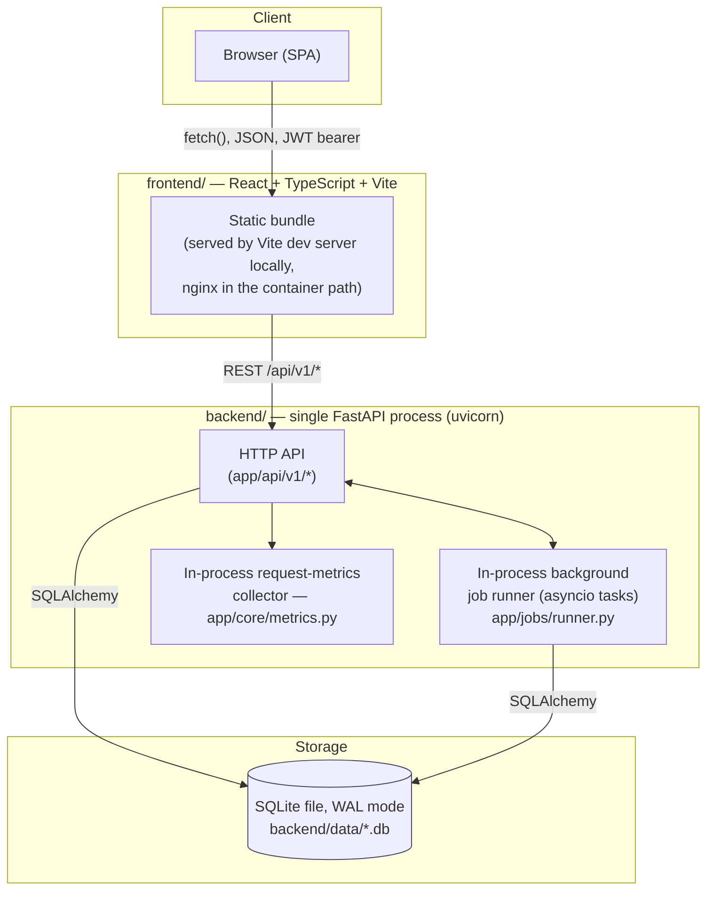
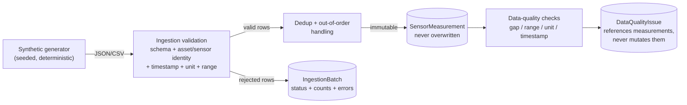
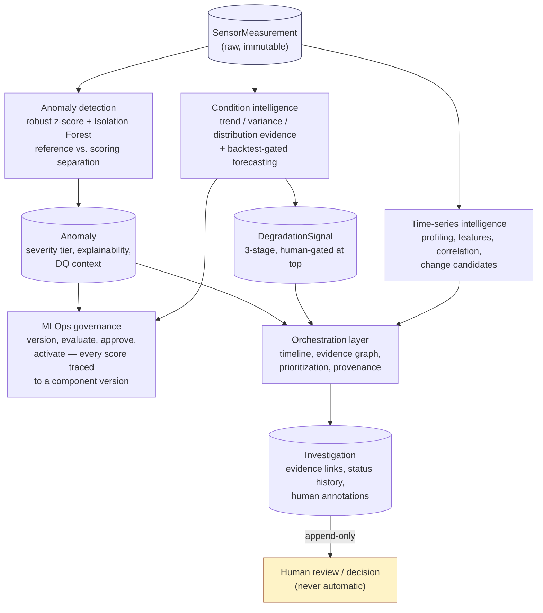
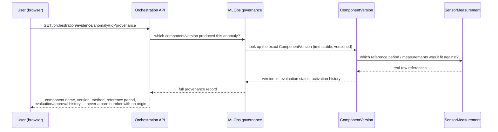
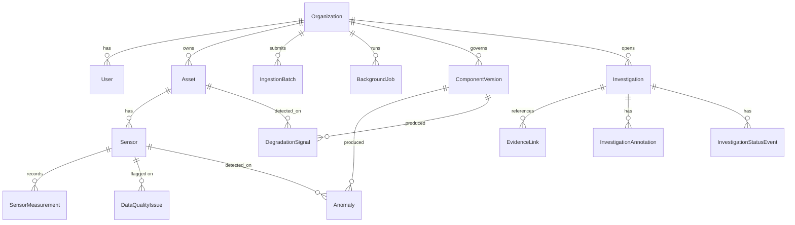
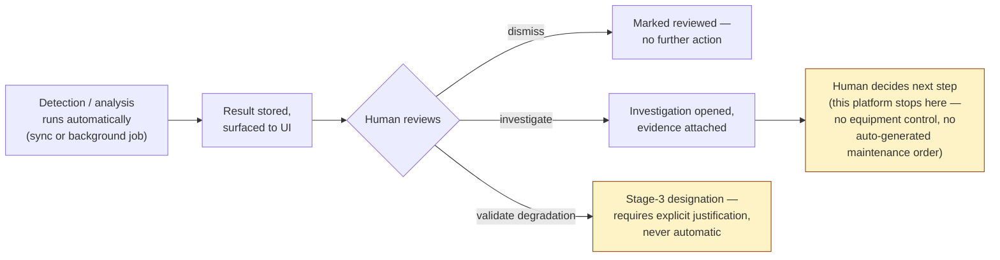

# Architecture Diagrams

Real diagrams of the actual system — not an imagined enterprise
deployment. Every box below corresponds to a real module or table in this
repository; nothing here is aspirational. See `ARCHITECTURE.md` for the
prose walkthrough and `docs/RELIABILITY_AND_OPERATIONS.md` §1 for the
deployment-environment detail.

## 1. System architecture (actual deployment shape)

**No message broker, no cache, no third-party API call, no separate
worker process anywhere in this system.** The background job runner lives
inside the same uvicorn process as the API — there is one deployable
backend and one deployable frontend, full stop. This is a deliberate
modular-monolith choice (`ARCHITECTURE.md` §3/§4), not a placeholder for a
microservices design that was never built.

## 2. Data flow — ingestion to storage

The hard boundary enforced end to end: **raw measurements are immutable.**
Nothing downstream — quality checks, features, models — ever overwrites a
`SensorMeasurement` row. Every derived table carries a foreign key back to
what it was derived from.

## 3. Intelligence flow — from raw data to an investigable signal

This is the real shape of "decision support, not autonomous control": every
path terminates in evidence presented to a human, and nothing in this
diagram writes a maintenance action back to equipment — there is no such
integration in this system.

## 4. Provenance flow — how an output traces back to its source

Every intelligence output the frontend renders can be traced through this
same chain — this is what "provenance" means concretely in this platform,
not a marketing word: a real foreign-key path from a displayed number back
to the exact code version and data window that produced it.

## 5. Domain model (core relationships)

`EvidenceLink` is a reference, never a copy — it points at an `Anomaly`,
`DegradationSignal`, or other evidence row by id; an investigation never
duplicates or mutates the evidence it cites (`docs/INTELLIGENCE_ORCHESTRATION.md`
§2).

## 6. Control flow — what the system does and does not automate

